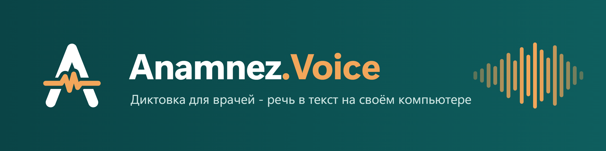

  

**Anamnez.Voice** - программа для диктовки. Говоришь, и текст появляется там, где стоит курсор: в медицинской карте, письме, чате. Речь распознаётся на твоём компьютере и никуда не отправляется.

- **Без облака.** Звук и текст остаются на компьютере, интернет для работы не нужен.
- **Знает термины.** Словарь профиля исправляет слова, которые модель расслышала неверно.
- **Профили под работу.** «Про» - для текстов с техническими терминами, «Врач» - для медицинских записей (в разработке).

**Сейчас:** закрытая разработка. Первая версия - для Windows, следом Linux.
